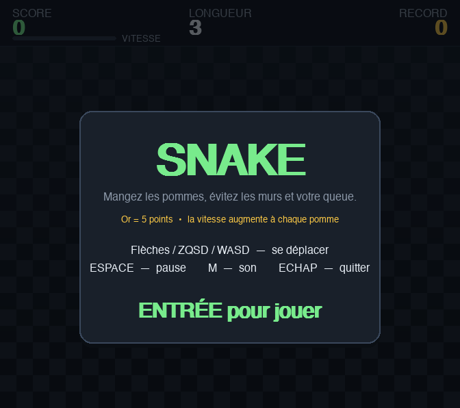
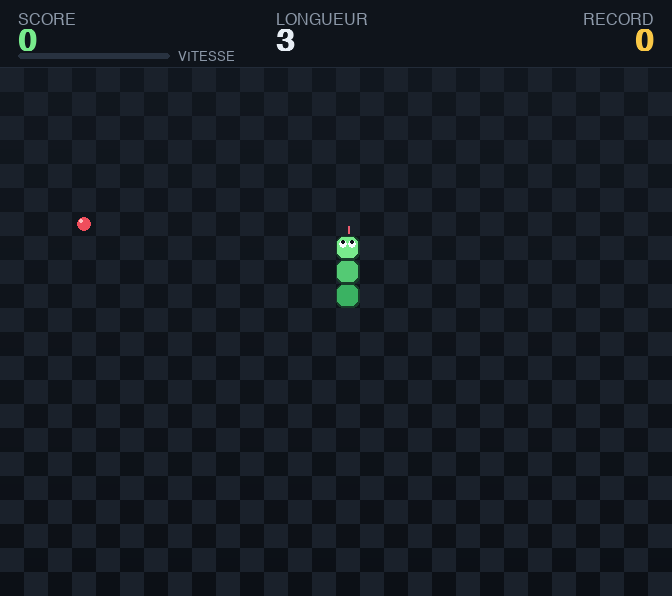

# Snake 🐍

Un jeu de serpent complet en Python avec **pygame**.




## Lancer le jeu

```bash
git clone https://github.com/davidagoua/jeu-snake.git
cd jeu-snake
pip install pygame
python3 snake.py
```

Testé avec Python 3.13 et pygame 2.6.1, sur macOS. Le jeu n'utilise que pygame :
aucune autre dépendance, aucun fichier de ressources externe.

## Contrôles

| Touche | Action |
| --- | --- |
| `↑` `↓` `←` `→` ou `ZQSD` / `WASD` | Se déplacer |
| `ENTRÉE` | Démarrer / rejouer |
| `ESPACE` ou `P` | Pause |
| `M` | Couper / réactiver le son |
| `ÉCHAP` | Retour au menu (puis quitter) |

## Règles

- Mangez les pommes rouges : **+1 point**, le serpent s'allonge d'une case.
- Les pommes **dorées** (à partir de 5 pommes) valent **+5 points**.
- La **vitesse augmente** à chaque pomme mangée — la barre `VITESSE` du bandeau
  indique où vous en êtes.
- Un mur ou votre propre corps = fin de partie.
- Le meilleur score est conservé dans `highscore.json`.

## Fonctionnalités

- Écran d'accueil, pause et écran de fin de partie
- Damier en dégradé, serpent dégradé avec yeux orientés et langue animée
- Pommes pulsantes, halo pour les pommes dorées
- Particules, tremblement d'écran et flash à chaque événement
- Effets sonores **générés en mémoire** (aucun fichier audio requis)
- Record persistant, gestion du demi-tour et du tampon d'entrées
  (appuyer sur deux touches rapidement ne fait jamais perdre la partie)

## Fichiers

| Fichier | Rôle |
| --- | --- |
| `snake.py` | Le jeu (logique + rendu + sons + boucle principale) |
| `test_snake.py` | Tests sans écran : règles, collisions, rendu, record, sons |
| `smoke_run.py` | Lance la vraie boucle `main()` avec des touches simulées et capture des images |
| `captures/` | Captures générées par `smoke_run.py` |

## Vérifier que tout fonctionne

Les tests tournent sans ouvrir de fenêtre (pilotes SDL factices) :

```bash
python3 test_snake.py     # règles du jeu, collisions, rendu, record, sons
python3 smoke_run.py      # parcours complet : menu -> jeu -> pause -> fin -> menu
```

`test_snake.py` couvre le déplacement, le demi-tour interdit, la pomme normale et
la pomme dorée, la collision avec les murs, la morsure de sa propre queue (et le
cas légal de suivre sa queue), la pause, la vitesse, le rendu des quatre écrans,
les scores extrêmes et les effets sonores.
